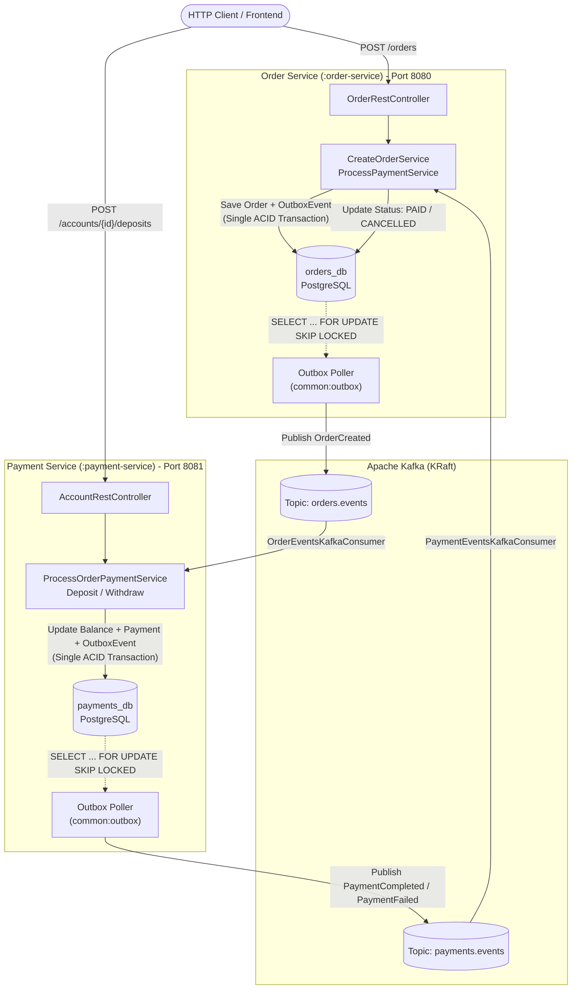
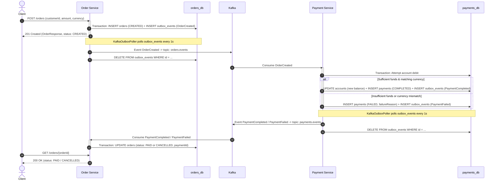

# E-Commerce Microservices System

A portfolio project showcasing a distributed microservices architecture built with Kotlin and Spring Boot, asynchronous event-driven communication (Event-Driven Architecture) via Apache Kafka, and Domain-Driven Design / Hexagonal Architecture (Ports and Adapters).

This project was created to demonstrate modern software engineering practices in the JVM ecosystem: strong domain typing, functional error handling, data consistency guarantees without distributed two-phase transactions (Transactional Outbox Pattern), and a comprehensive testing pyramid powered by Testcontainers.

---

## Table of Contents

- [System Architecture](#system-architecture)
  - [Architectural Principles](#architectural-principles)
  - [Business Workflow (Saga / Event Choreography)](#business-workflow-saga--event-choreography)
  - [Transactional Outbox Pattern](#transactional-outbox-pattern)
- [Project Structure & Modules](#project-structure--modules)
  - [Hexagonal Architecture per Module](#hexagonal-architecture-per-module)
- [Implemented Features](#implemented-features)
  - [Order Service](#order-service)
  - [Payment Service](#payment-service)
- [Tech Stack](#tech-stack)
- [Code Quality & Standards](#code-quality--standards)
- [Getting Started](#getting-started)
  - [Prerequisites](#prerequisites)
  - [Environment Configuration](#environment-configuration)
  - [Option 1: Hybrid Local Development (Recommended)](#option-1-hybrid-local-development-recommended)
  - [Option 2: Full Docker Environment](#option-2-full-docker-environment)
  - [Running Tests & Quality Checks](#running-tests--quality-checks)
- [API Documentation & Tooling](#api-documentation--tooling)
  - [Swagger UI / OpenAPI](#swagger-ui--openapi)
  - [Bruno API Collection](#bruno-api-collection)
  - [Admin Panels & Observability](#admin-panels--observability)
- [End-to-End Demo Scenario](#end-to-end-demo-scenario)

---

## System Architecture

The system consists of independent microservices communicating asynchronously through **Apache Kafka**:



### Architectural Principles

1. **Database-per-Service**: Each microservice maintains its own logically isolated PostgreSQL database (`orders_db` and `payments_db`). Direct database access across service boundaries is strictly prohibited.
2. **Event-Driven Architecture (EDA)**: Inter-service communication is purely event-driven over Apache Kafka, preventing synchronous blocking, runtime cascading failures, and temporal coupling.
3. **Eventual Consistency**: Replaced distributed 2-phase commit (2PC) transactions with an asynchronous saga choreography model.
4. **Idempotent Consumers**: Safeguards against duplicate Kafka message delivery (at-least-once delivery):
   - In `payment-service`: checks existing payment records for the specified `orderId` prior to modifying account balances.
   - In `order-service`: state transitions are idempotent (receiving the same event again produces no additional side effects).
5. **Functional Error Handling (Arrow Core)**:
   - Business use cases leverage `Either<Failure, Success>` instead of throwing untyped runtime exceptions for predictable business validation failures (e.g., insufficient funds, currency mismatch).
   - Kotlin Value Classes (`@JvmInline value class`) are utilized for identifiers (`OrderId`, `CustomerId`, `AccountId`, `PaymentId`) and value objects (`Money`), eliminating *primitive obsession* with zero heap allocation overhead.

---

### Business Workflow (Saga / Event Choreography)



---

### Transactional Outbox Pattern

The shared module [`:common:outbox`](file:///Users/paweltobiszewski/Projects/order-service/main/common/outbox) solves the *Dual-Write* challenge in distributed architectures:

- Instead of publishing directly to Kafka within the HTTP request transaction (which risks message loss if Kafka is unreachable or data inconsistency if the database transaction rolls back), events are persisted into the `outbox_events` table within the same ACID database transaction.
- A background worker (`KafkaOutboxPoller`) polls pending events periodically using:
  ```sql
  SELECT id, aggregate_id, topic, event_type, created_at, payload, retry_count, last_error
  FROM outbox_events
  ORDER BY created_at ASC
  LIMIT :batchSize
  FOR UPDATE SKIP LOCKED;
  ```
  The `FOR UPDATE SKIP LOCKED` clause enables safe horizontal scaling across multiple application instances without race conditions or locks contention.
- Upon successful Kafka acknowledgment, the record is removed from the outbox table. If delivery fails, the `retry_count` is incremented and the `last_error` is tracked for monitoring.

---

## Project Structure & Modules

The repository is organized as a Gradle multi-module project:

```
ecommerce-system/
├── common/
│   └── outbox/                 # Shared infrastructure library / Spring Boot auto-configuration
│       └── src/main/kotlin/    # OutboxRepository, KafkaOutboxPoller, OutboxAutoConfiguration
├── order-service/              # Order management microservice (port 8080)
│   ├── src/main/kotlin/        # Pure domain, use cases, REST controllers, JPA & Kafka adapters
│   ├── src/main/resources/     # application.yml, Flyway migrations (db/migration/V1..V4)
│   ├── src/test/kotlin/        # Unit tests, WebMvcTest, DataJpaTest, Testcontainers
│   └── Dockerfile              # Multi-stage OCI build with Spring Boot layer extraction
├── payment-service/            # Payment & customer account microservice (port 8081)
│   ├── src/main/kotlin/        # Multi-currency accounts, deposit/withdraw, payment processing
│   ├── src/main/resources/     # application.yml, Flyway migrations (db/migration/V1..V3)
│   ├── src/test/kotlin/        # Unit tests, Testcontainers integration suites
│   └── Dockerfile              # Multi-stage OCI build with Spring Boot layer extraction
├── bruno/                      # Bruno API collection for manual and automated HTTP testing
├── docker/
│   └── postgres/init.sh        # PostgreSQL initialization script (provisions orders_db & payments_db)
├── .run/                       # IntelliJ IDEA run configurations (Infra, order-service, payment-service)
├── compose.yaml                # Docker Compose (PostgreSQL, Kafka, services, Kafka-UI, Adminer)
└── lefthook.yml                # Git hooks configuration (Ktlint & Detekt pre-commit / pre-push)
```

### Hexagonal Architecture per Module

Each business service follows a clean Ports & Adapters separation:

```
[service]/src/main/kotlin/...
├── domain/                     # Business core (Pure Kotlin, zero framework dependencies)
│   ├── model/                  # Domain entities, Value Objects, domain events
│   └── port/
│       ├── incoming/           # Use Cases (driver interfaces) + Commands / Queries
│       └── outgoing/           # Driven port interfaces (RepositoryPort, EventPublisherPort)
├── application/                # Application orchestration layer
│   └── service/                # Use case implementations, domain orchestration & transactions
└── infrastructure/             # Driven & driving infrastructure adapters
    ├── rest/                   # Spring MVC REST controllers, DTOs, mappers, RFC 7807 ProblemDetail
    ├── persistence/            # JPA / Hibernate entities, Spring Data Repositories, port adapters
    ├── kafka/                  # KafkaListener consumers, message DTOs
    └── outbox/                 # Outbox persistence adapter calling OutboxRepository
```

This ensures domain logic remains decoupled from frameworks, transport layers, and databases, allowing it to be tested in complete isolation.

---

## Implemented Features

### Order Service

- **Create Order (`POST /orders`)**:
  - Request validation (positive decimal amount, valid ISO-4217 3-letter currency code, non-blank customer ID).
  - Creates the order aggregate in `CREATED` status.
  - Persists the order and queues an `OrderCreated` event to the outbox atomically.
  - Returns HTTP `201 Created` with a `Location: /orders/{id}` header and response payload.
- **Get Order by ID (`GET /orders/{id}`)**:
  - Retrieves order details including current status (`CREATED`, `PAID`, `CANCELLED`) and associated `paymentId`.
- **Get Customer Orders (`GET /orders?customerId=...`)**:
  - Lists all orders belonging to a specific customer.
- **Get All Customers (`GET /orders/customers`)**:
  - Lists unique customer identifiers that have placed orders.
- **Asynchronous Payment Result Processing (Kafka Consumer)**:
  - `PaymentCompleted` $\rightarrow$ marks order as `PAID`.
  - `PaymentFailed` $\rightarrow$ marks order as `CANCELLED` and records the payment transaction ID.

### Payment Service

- **Multi-Currency Account Management**:
  - **Deposit (`POST /accounts/{customerId}/deposits`)**: Adds funds in a given currency. Automatically initializes a new currency account for the customer if none exists.
  - **Withdraw (`POST /accounts/{customerId}/withdraws`)**: Deducts funds with strict balance checks. Guarded against negative balances and currency mismatches (returns HTTP `422 Unprocessable Content` using RFC 7807 Problem Detail).
  - **Get Accounts (`GET /accounts/{customerId}`)**: Returns all currency accounts and balances for a given customer.
- **Order Payment Processing (Kafka Consumer)**:
  - Listens to `orders.events` for `OrderCreated`.
  - Enforces idempotency against the `payments` table.
  - Attempts account withdrawal matching the order amount and currency.
  - Publishes outcome via Outbox: `PaymentCompleted` upon success or `PaymentFailed` upon insufficient funds or currency mismatch.

---

## Tech Stack

| Area | Technology / Tool | Description |
| :--- | :--- | :--- |
| **Language** | Kotlin 2.4.x | Target JVM 21, null-safety, value classes |
| **Framework** | Spring Boot 4.1.x | WebMVC, Data JPA, Kafka, Actuator |
| **Database** | PostgreSQL 16 Alpine | Dedicated relational databases (`orders_db`, `payments_db`) |
| **Database Migrations** | Flyway | Independent versioned schema migrations per microservice |
| **Message Broker** | Apache Kafka 4.3.x | Event broker running in KRaft mode (no Zookeeper) |
| **Functional Library** | Arrow Core 2.3.x | Typed error handling (`Either`, `raise` DSL) |
| **Formatting & Linting** | Ktlint, Detekt | Static analysis and Kotlin code formatting rules |
| **Git Hooks** | Lefthook | Fast pre-commit (`ktlint --format`, `detekt`) and pre-push checks |
| **Testing** | Kotest & JUnit 5 | Expressive matchers and testing framework |
| **Integration Testing**| Testcontainers | Real PostgreSQL and Kafka containers via Spring Boot `@ServiceConnection` |
| **API Documentation** | Springdoc OpenAPI | Swagger UI endpoints generated from code annotations |
| **API Client** | Bruno | Human-readable Git-friendly HTTP request collection |
| **Containerization** | Docker & Docker Compose | Multi-stage Dockerfiles with Spring Boot layer tools |

---

## Code Quality & Standards

The codebase enforces strict code style and static analysis:

- **Ktlint**: Enforces standard Kotlin code conventions.
- **Detekt**: Analyzes code smells, cyclomatic complexity, unused parameters, and potential bugs.
- **Lefthook**: Coordinates Git hooks:
  - **Pre-commit**: Formats staged files (`ktlint --format`) and runs targeted static analysis (`detekt`).
  - **Pre-push**: Executes a full check across the repository (`./gradlew ktlintCheck detekt`).

Manual quality check:
```bash
./gradlew ktlintCheck detekt
```

Automatic formatting:
```bash
./gradlew ktlintFormat
```

---

## Getting Started

### Prerequisites

- **JDK 21** (e.g., Eclipse Temurin 21)
- **Docker** and **Docker Compose v2+**

### Environment Configuration

Create your `.env` file from the provided example:

```bash
cp .env.example .env
```

Default values in `.env`:
```env
POSTGRES_USER=postgres
POSTGRES_PASSWORD=password
POSTGRES_PORT=5432
POSTGRES_DB_ORDERS=orders_db
```

---

### Option 1: Hybrid Local Development (Recommended)

In this mode, shared infrastructure (PostgreSQL and Kafka) runs in Docker, while the microservices run locally on your host machine for fast turnaround and seamless debugging.

1. **Start the infrastructure containers**:
   ```bash
   docker compose up -d database kafka
   ```
   *(Optional: append `--profile tools` to also spin up Kafka UI and Adminer).*

2. **Run Order Service (Terminal 1)**:
   ```bash
   ./gradlew :order-service:bootRun
   ```
   Listens on port **8080**.

3. **Run Payment Service (Terminal 2)**:
   ```bash
   ./gradlew :payment-service:bootRun
   ```
   Listens on port **8081**.

> [!TIP]
> If you are using IntelliJ IDEA, pre-configured run configurations are ready in `.run/`:
> - `Infra`: Starts database, Kafka, and monitoring tools via Docker.
> - `order-service`: Launches Order Service with `.env` mapped.
> - `payment-service`: Launches Payment Service with `.env` mapped.

---

### Option 2: Full Docker Environment

Run the entire microservices stack in Docker containers using the `app` profile:

```bash
docker compose --profile app up -d --build
```

To include developer tools (Kafka UI, Adminer):
```bash
docker compose --profile app --profile tools up -d --build
```

Stop the environment:
```bash
docker compose --profile app --profile tools down
```
*(Add `-v` to wipe database volumes as well).*

---

### Running Tests & Quality Checks

The testing suite comprises:
- Isolated unit tests for domain entities and application services.
- Web slice tests (`@WebMvcTest`) for REST controllers and exception handlers.
- Data persistence integration tests (`@DataJpaTest`) with PostgreSQL Testcontainers.
- End-to-end outbox pipeline tests (`@SpringBootTest`) with Kafka & Postgres Testcontainers and `Awaitility`.

To execute all tests across modules:
```bash
./gradlew test
```
*(Ensure Docker daemon is running, as Testcontainers will start containers dynamically during test execution).*

---

## API Documentation & Tooling

### Swagger UI / OpenAPI

Once services are running, interactive Swagger UI is available at:
- **Order Service Swagger UI**: [http://localhost:8080/swagger-ui/index.html](http://localhost:8080/swagger-ui/index.html)
- **Payment Service Swagger UI**: [http://localhost:8081/swagger-ui/index.html](http://localhost:8081/swagger-ui/index.html)

### Bruno API Collection

A ready-to-use collection for the [Bruno](https://www.usebruno.com/) API client is available in [`bruno/order-service`](file:///Users/paweltobiszewski/Projects/order-service/main/bruno/order-service):
- `orders/Create order.yml`
- `orders/Get order by id.yml`
- `orders/Get customer orders.yml`
- `orders/Get customers.yml`
- `payments/Deposit funds.yml`
- `payments/Withdraw funds.yml`
- `payments/Get customer accounts.yml`

### Admin Panels & Observability

When running with `--profile tools`:
- **Kafka UI**: [http://localhost:8085](http://localhost:8085) – Inspect topics (`orders.events`, `payments.events`), partitions, consumer groups, and message headers/payloads.
- **Adminer (Database GUI)**: [http://localhost:8082](http://localhost:8082) – Web database management (System: PostgreSQL, Server: `database`, Username: `postgres`, Password: `password`).
- **Spring Boot Actuator Health**:
  - Order Service: [http://localhost:8080/actuator/health](http://localhost:8080/actuator/health)
  - Payment Service: [http://localhost:8081/actuator/health](http://localhost:8081/actuator/health)

---

## End-to-End Demo Scenario

You can verify the end-to-end event choreography flow using `curl`:

#### 1. Deposit 250 PLN into customer `cust_001`'s account:
```bash
curl -X POST http://localhost:8081/accounts/cust_001/deposits \
  -H "Content-Type: application/json" \
  -d '{"amount": "250.00", "currencyCode": "PLN"}'
```

#### 2. Verify account balance:
```bash
curl http://localhost:8081/accounts/cust_001
```

#### 3. Create an order for 100 PLN:
```bash
curl -i -X POST http://localhost:8080/orders \
  -H "Content-Type: application/json" \
  -d '{"customerId": "cust_001", "amount": "100.00", "currencyCode": "PLN"}'
```
*The immediate response returns HTTP `201 Created` with status `CREATED` and header `Location: /orders/{orderId}`.*

#### 4. Verify order status after asynchronous processing (wait ~1-2 seconds):
```bash
# Replace {orderId} with the ID returned in step 3
curl http://localhost:8080/orders/{orderId}
```
*The order status transitioned to `PAID`, and `paymentId` is populated.*

#### 5. Test failure scenario (insufficient balance):
Place an order exceeding the remaining customer balance (e.g., 500 PLN):
```bash
curl -X POST http://localhost:8080/orders \
  -H "Content-Type: application/json" \
  -d '{"customerId": "cust_001", "amount": "500.00", "currencyCode": "PLN"}'
```
Wait ~1-2 seconds and check the order status:
```bash
curl http://localhost:8080/orders/{newOrderId}
```
*The order status is `CANCELLED` – Payment Service rejected the transaction due to insufficient funds.*
